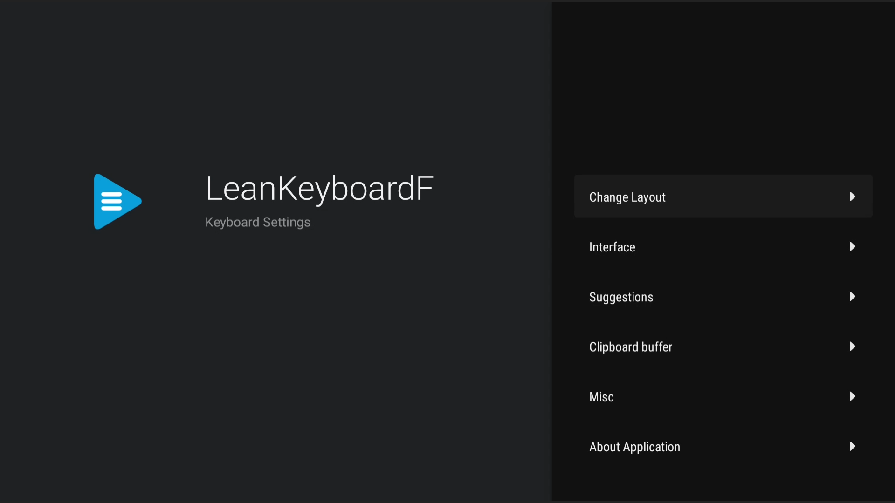
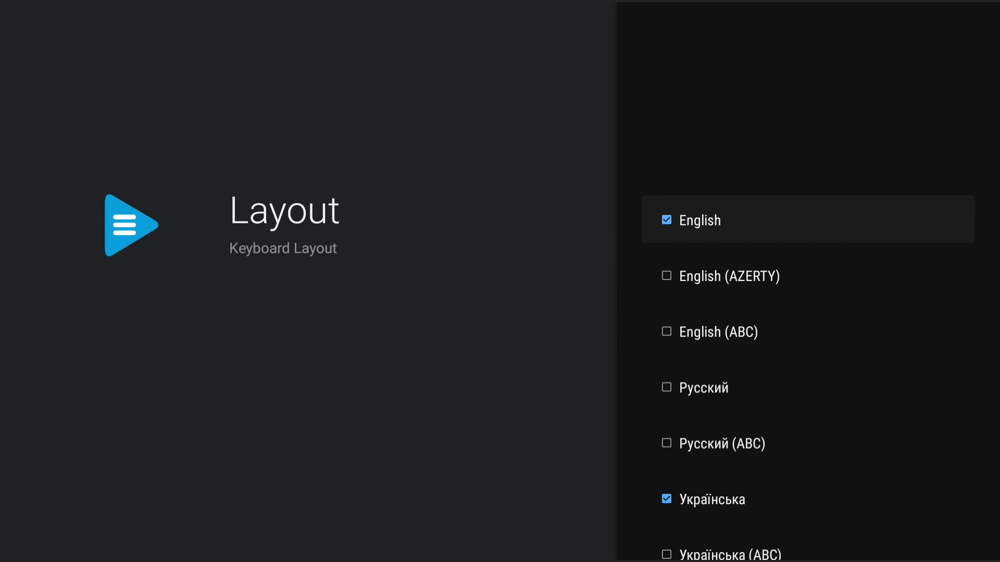

 LeanKeyboardF
=========

[](./LICENSE)
[](https://github.com/LeanKeyboardF/LeanKeyboardF/releases)
[](https://github.com/LeanKeyboardF/LeanKeyboardF/stargazers)
[](https://github.com/LeanKeyboardF/LeanKeyboardF/releases)

**LeanKeyboardF** is a fork of [LeanKeyboard](https://github.com/yuliskov/LeanKeyboard) — a lightweight keyboard designed for Android-based set-top boxes and TVs.

> **What is LeanKeyboard?**  
> [Click here to read the original LeanKeyboard README](https://github.com/LeanKeyboardF/LeanKeyboardF/blob/master/READMEoriginal.md)

### About this fork

LeanKeyboardF aims to extend the original project with additional tools for keyboard customization, bug fixes, and new features while keeping the core experience intact.

- **Author / Maintainer**: [AmakerGame](https://github.com/AmakerGame) (Edytor-Studio Core)
- **Base project**: [yuliskov/LeanKeyboard](https://github.com/yuliskov/LeanKeyboard)
- **This project**: [LeanKeyboardF/LeanKeyboardF](https://github.com/LeanKeyboardF/LeanKeyboardF/tree/master)
- **Site**: [leankeyboardf.github.io](https://leankeyboardf.github.io/)
- **XDA Forums thread**: [xdaforums.com/t/leankeyboardf.4799086](https://xdaforums.com/t/leankeyboardf.4799086/)

---

### Screenshots

<p align="center">
  
  
</p>

<p align="center"><em>Settings (left) and keyboard layout selection (right)</em></p>

---

### Features (inherited from LeanKeyboard)

- Designed specifically for TV screens
- Works with any remote controller
- Supports dozens of languages
- Does not depend on Google Services
- **No root required**

**Tips:**
- Switch language using the language button or by long-pressing the space bar
- Long-press the language button to select from available languages

---

### Added features

- Keyboard size: https://github.com/yuliskov/LeanKeyboard/issues/73
- Floating keyboard: https://github.com/yuliskov/LeanKeyboard/issues/47
- Portuguese (Brazil) language: https://github.com/yuliskov/LeanKeyboard/issues/53
- Portuguese (Portugal) language: https://github.com/yuliskov/LeanKeyboard/issues/80
- Japanese language (日本語): interface translation and two 50-sound (gojūon) kana keyboards - hiragana (**日本語**) and katakana (**日本語 (カタカナ)**). The **゛゜** key changes the previous kana (か → が, は → ば → ぱ, つ → っ → づ, や → ゃ ...). Digits, punctuation and the five least used kana (ぬ ね む ゆ ろ) are on the Shift layer - or just long-press a key to get its second character
- New keyboard themes: Light, System (follows device theme), and Dynamic Color (Material You, Android 12+)
- Clipboard action row (Select All, Copy, Cut, Paste, Clear) next to the keyboard, with icon buttons
- "Buffer" clipboard history key - shows recently copied/cut items to pick from
- Learn Keyboard: learns words and word-pairs you type and suggests them, ranked by how often you use them - idea by [selivanoff](https://4pda.to/forum/index.php?showuser=1729354)
- ABC layout for all languages supported in LeanKeyboardF
- Last five words: quickly access the five most recently used words
- Last word button: quickly insert the most recently used word
- Clear word history: clear the recent word history from settings
- **Advanced** subsection in **Settings → Misc** for troubleshooting options
- **Legacy Android mode** for Android 4.4–6, providing improved compatibility with older Android versions
- Compatibility fallbacks for older Android versions, including legacy layouts, icons, touch feedback and clipboard icon handling
- Compatibility diagnostics through the `LbCompat` log tag when Debug logging is enabled
- **In-app program updates**
- **Accessibility** section in Settings, with an optional accessibility service for:
  - **Text field detection** - shows the keyboard automatically when a text field gets focus but the system never asked for the keyboard on its own (common on some Android TV apps)
  - **Physical key detection** - makes sure Enter, Alt, Shift and Escape from an attached hardware keyboard reach the keyboard even if the system doesn't deliver them on its own
  - **Mic button interception** - while the keyboard is shown, the remote's voice/assist/search button starts the keyboard's own voice input instead of its usual action; a device-specific mic button can be assigned from Settings if the built-in codes don't match your remote
- **Hide Activate Keyboard** / **Hide Accessibility** toggles in Settings → Interface, for tidying up the main Settings menu

---

### Installation via ADB

1. If you are not familiar with sideloading apps via ADB, read a tutorial (for example [this one](http://kodi.wiki/view/HOW-TO:Install_Kodi_on_Fire_TV)).
2. Download the latest APK from the [Releases](https://github.com/LeanKeyboardF/LeanKeyboardF/releases) page.
3. Install with ADB:
   ```bash
   adb install -r LeanKeyboardF.apk
   ```
4. Enjoy!

---

### Debug logging

Off by default. To trace physical-keyboard / mini-keyboard (accent popup) key
handling on a device:

1. Open **Settings -> Misc -> Advanced -> Debug logging** in the keyboard's own settings
   screen and turn it on (it's off by default, so no extra logs are produced
   normally).
2. Reproduce the issue.
3. Read the logs over ADB:
   ```bash
   adb logcat -s LbImeService LeanbackImeService LbKbContainer LbKbController LbSuggestionsFactory LbCompat
   ```
   (these are the log tags used across the `ime` package, plus `LbCompat` from Legacy Android mode; drop the ones you
   don't care about, or use `adb logcat | grep -E "LbImeService|LbKbContainer|LbKbController"`
   if `-s` filters too aggressively on your ADB version).
4. Turn the toggle back off when done - the app doesn't do it automatically.

---

### Legacy Android mode (Android 4, 5, 6)

Off by default. If the keyboard doesn't work on an old device (it crashes when
you type, or doesn't appear at all on Android 4.x), open
**Settings -> Misc -> Advanced** and turn on **Legacy Android mode**. The
keyboard service then avoids APIs added in Android 7 (`List.sort`,
`Comparator.comparingInt`) and Android 5 (vector drawables, ripple, image
tint) and uses older equivalents instead. With it off, nothing changes. The
practical minimum is Android 4.4 (API 19). The change applies the next time
the keyboard is opened.

If you change `input_leanback*.xml` or `root_leanback*.xml`, mirror the change
in the matching `*_compat.xml`.

---

### Accessibility features

Off by default, and each switched on separately.

1. Open **Settings -> Accessibility** in the keyboard's own settings screen.
   This opens Android's system Accessibility list - find "LeanKeyboardF" there
   and turn the service on (Android requires this extra step for any
   accessibility service, it can't be turned on from inside the app alone).
2. Back in the keyboard's own **Settings -> Accessibility -> Settings**
   screen, turn on whichever features you want:
   - **Text field detection** - shows the keyboard automatically when a text
     field gets focus but nothing asked for the keyboard on its own.
   - **Physical key detection** - forwards Enter/Alt/Shift/Escape from an
     attached hardware keyboard to the keyboard's own handling for those
     keys if the system doesn't deliver them on its own. Only does anything
     together with **Settings -> Misc -> Physical keyboard support**, which
     is what actually acts on Alt/Shift once it sees them.
   - **Intercept Mic Button** - while the keyboard is shown, swallows the
     remote's voice/assist/search button press and starts the keyboard's own
     voice input instead. When the keyboard isn't shown, the button works as
     usual. If your remote's mic/AI button doesn't react, use **Assign Mic
     Button** on the same screen to press-and-capture its actual key code.

Turning the checkboxes off stops the corresponding behavior; turning the
service off in Android's Accessibility list stops both, regardless of the
checkboxes.

---

### Changelog

See the [Releases](https://github.com/LeanKeyboardF/LeanKeyboardF/releases) page for the full changelog.

---

### Contributors

**Original LeanKeyboard contributors:**
- [aglt](https://github.com/aglt) — Icelandic language
- [rabin111](https://github.com/rabin111) — Thai language

**Original developer:**
- [yuliskov](https://github.com/yuliskov) — design & coding

**LeanKeyboardF maintainer:**
- [AmakerGame](https://github.com/AmakerGame) (Edytor-Studio Core)
